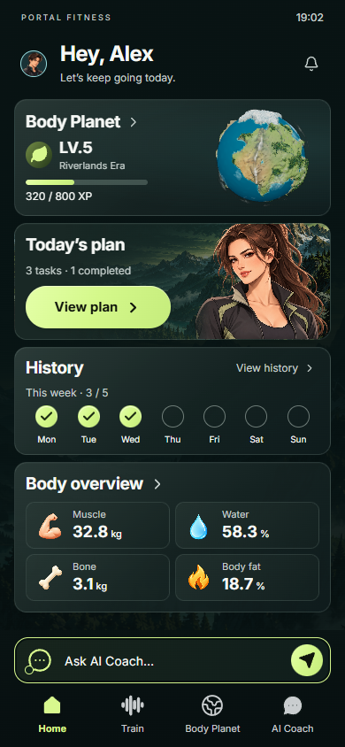
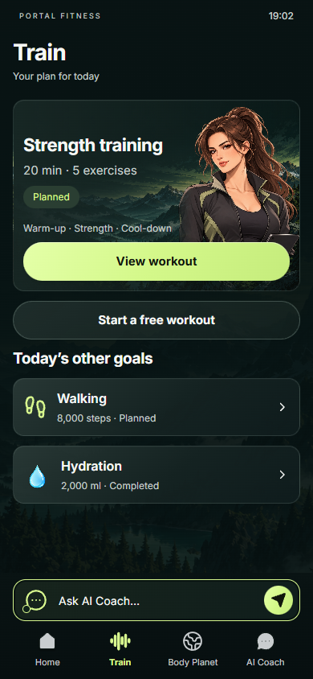
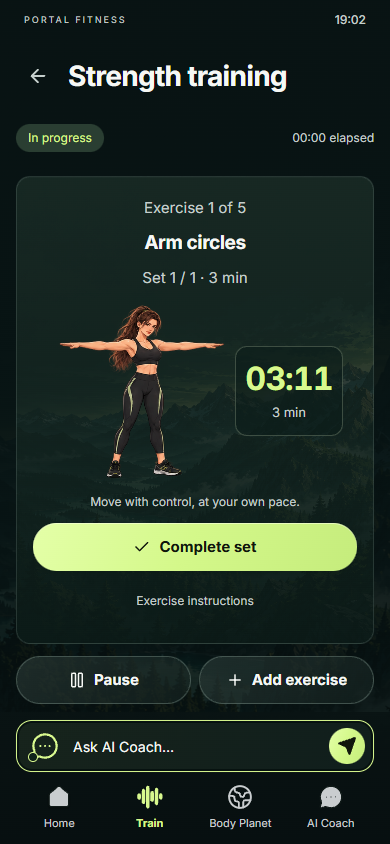
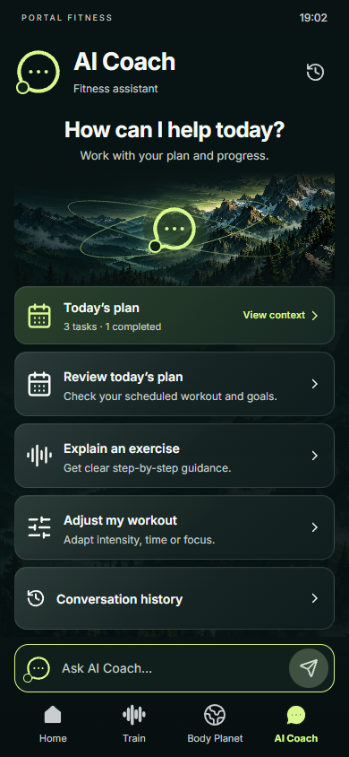

# 2026-10-11 · 视觉还原 V2

用户反馈首轮运行界面的配色、图标过于简单，要求严格参考已生成的交互稿执行。本轮修改独立开发目录 `D:\AIworkspace\portal-fitness-app`；保留原项目 `D:\AIworkspace\myplanet`。

## 设计依据

视觉依照 Home / Account / AI V6、Body Planet V5、Train V2 的确认图；操作、状态和错误规则继续依照正式 Figma V1。此前原生 Figma 转换把深墨绿材质、黄绿按钮和彩色指标图标简化成平灰基础组件，本轮修正运行代码，不把旧的平色组件当作最终视觉。**未声称原生 Figma V1 文件已同步本轮视觉调整。**

| 项目 | 修正前 | 当前实现 |
|---|---|---|
| 基底 | 平色 `#101419` | 墨绿 `#091313` 与低对比山地背景 |
| 主操作 | 淡绿 `#C2D995`、矩形按钮 | 黄绿 `#D8F88E`、高光与胶囊按钮 |
| 卡片 | 平灰填色与统一实线 | 深绿材质渐变、低亮边缘、局部自然插画 |
| 身体指标 | 只有文字 | 肌肉桃色、水蓝色、骨骼象牙色、脂肪金色图标；标签和单位保留 |
| 周记录 | 裸勾与方框 | 黄绿完成圆形与未完成空心圆 |
| 训练 | 文本动作列表 | 同一成年 Maya 的动作缩略图、动作选择和训练展示 |
| AI | 平色介绍卡 | 山地场景与抽象对话标记，语境与问题卡；可用状态仍由真实服务决定 |
| 账户 | 分散账户入口与小会员行 | 紧凑资料卡、独立会员卡和设置行 |
| 星球 | 首页低精度基础网格、远景隐藏森林 | 首页和主球体均加载实际 63 级网格；APP 全景显示真实树木与水系，独立图鉴保持渐进显示 |

`src/visual-refinement.css` 在基础 UI CSS 后加载，明确保存视觉覆盖；`src/ui.tsx` 统一彩色指标、动作 atlas 与 AI 标记。人物资产未覆盖，星球仍为真实 Three.js / worker / GLB。

## 接入素材与提示词

使用内置 **image_gen**，参考确认图和原 Maya 形象生成；无需外部付费生成服务。素材已保存到开发仓库，保留原始透明通道，通过 CSS background-position 选取 atlas 区域，没有把完整概念稿贴成页面。

| 运行素材 | 用途 | 提示词 |
|---|---|---|
| [body-metric-atlas.png](../../../../public/assets/visual-v2/body-metric-atlas.png) | 四个身体指标，2 × 2 sprite；首页、身体卡与编辑字段共用 | [asset-prompts.json](asset-prompts.json) |
| [alpine-night.png](../../../../public/assets/visual-v2/alpine-night.png) | 卡片和 AI 背景；不是星球 | [asset-prompts.json](asset-prompts.json) |
| [maya-exercise-atlas.png](../../../../public/assets/visual-v2/maya-exercise-atlas.png) | 八个动作与准备姿势，3 × 3 sprite | [exercise-asset-prompt.json](exercise-asset-prompt.json) |

## 运行对照

`before/` 是本轮修改前的真实网页截图；`after/` 是本轮网页实际渲染，包括四个主页、账户、今日计划、计划编辑、动作列表、训练中、动作选择、指标选中和身体编辑。不是生成的界面概念图。

`verification.json` 保存浏览器错误、320/390/430/1280 布局检查、接入素材尺寸/哈希和真实星球运行信息。`scripts/visual-refinement-check.mjs` 可复现对照截图。交互回归、生产构建和原项目保护检查见上级 `VERIFICATION.md`、`delivery-check.json`。
